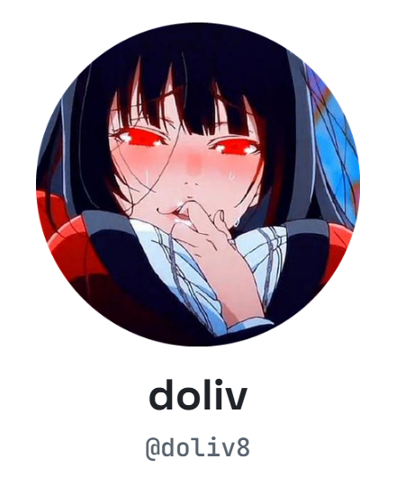
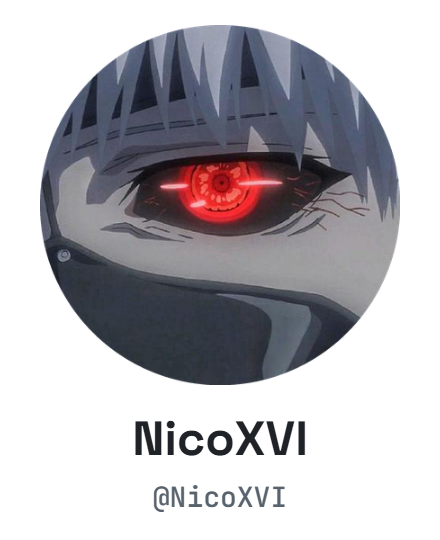
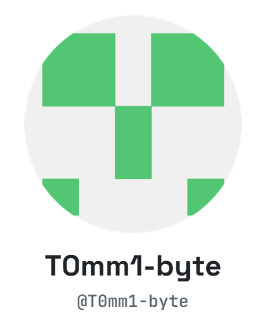
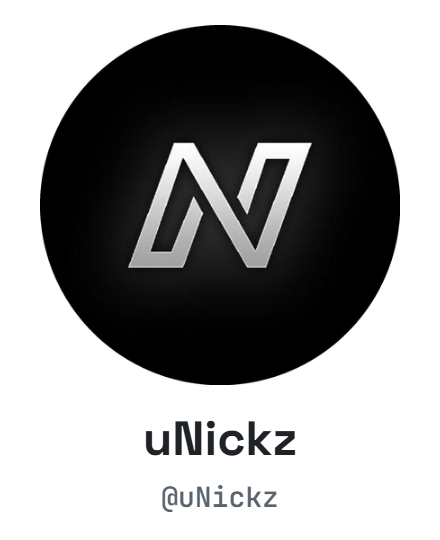
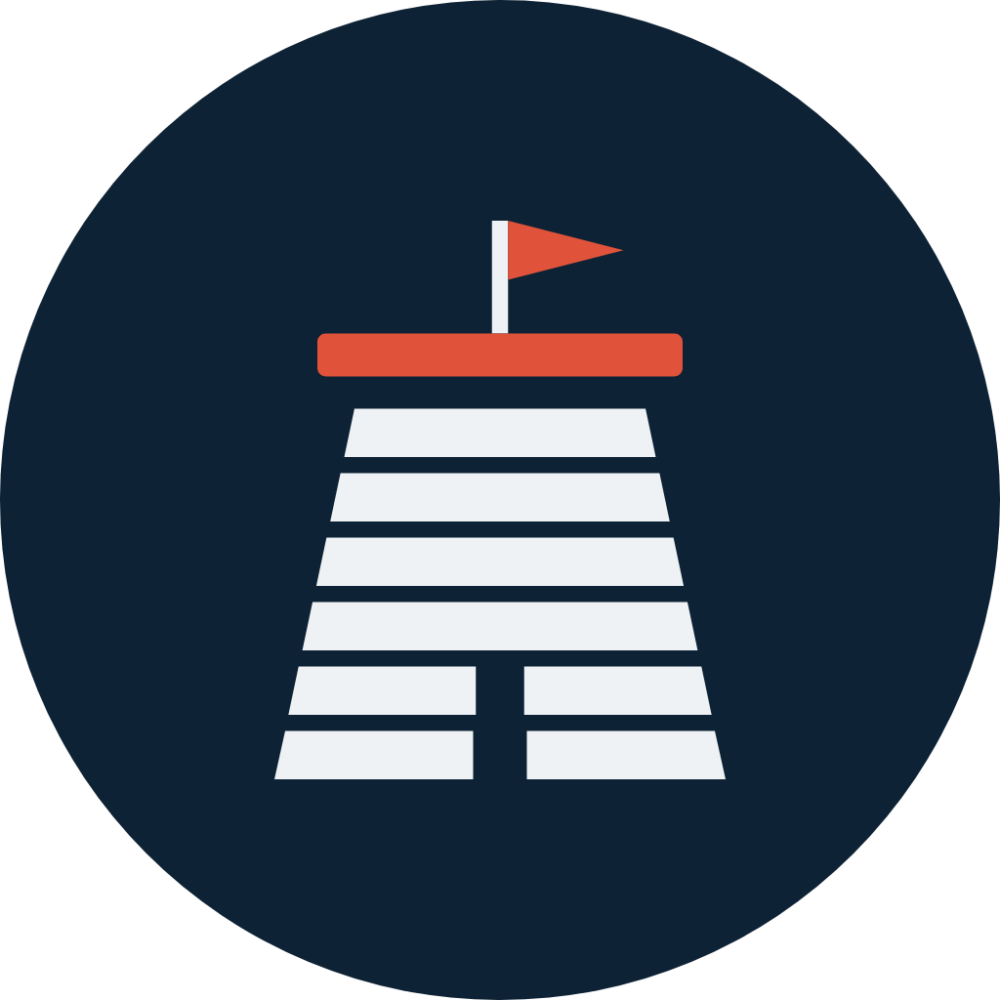

  

  A group of friends from Sardinia who build things at hackathons.

 

## Projects

| Date | Hackathon | Project | Description | Position | Prize |
|---|---|---|---|:---:|---|
| Nov 2026 | [IXH26 Italian XRPL Hackathon](https://www.decifris.it/ixh26/), Bari | [**ripple-guardian**](https://github.com/Cyber-Guys/ripple-guardian) | Blockchain forensics framework for the XRP Ledger. Owners get plain-language alerts when keys change or funds leave; analysts trace stolen XRP hop by hop to the exchange and destination tag. | - | - |
| Oct 2026 | [GreenLab Sardegna Hackathon](https://web.unica.it/unica/protected/543583/0/def/ref/AVS543582/) | **Sentinelle** | Citizen reporting and gamification against wildfires in Sardinia. Citizens report fires and complete prevention missions; operators get reports already verified and ranked by priority. | - | - |
| Jun 2026 | [Code the Continuum, CEI-Sphere](https://web.unica.it/unica/page/en/ceisphere_hackathon_in_cagliari__30_june_and_1_july), Cagliari | **CoreFleet** | Award-winning proof of concept platform. | - | - |

## Team

  <a href="https://github.com/DenInDev"><picture><source media="(prefers-color-scheme: dark)" srcset="assets/team/DenInDev-dark.png"></picture></a>&nbsp;&nbsp;
  <a href="https://github.com/doliv8"><picture><source media="(prefers-color-scheme: dark)" srcset="assets/team/doliv8-dark.png"></picture></a>&nbsp;&nbsp;
  <a href="https://github.com/NicoXVI"><picture><source media="(prefers-color-scheme: dark)" srcset="assets/team/NicoXVI-dark.png"></picture></a>
    
  <a href="https://github.com/AndreaCerolini"><picture><source media="(prefers-color-scheme: dark)" srcset="assets/team/AndreaCerolini-dark.png"></picture></a>&nbsp;&nbsp;
  <a href="https://github.com/T0mm1-byte"><picture><source media="(prefers-color-scheme: dark)" srcset="assets/team/T0mm1-byte-dark.png"></picture></a>&nbsp;&nbsp;
  <a href="https://github.com/uNickz"><picture><source media="(prefers-color-scheme: dark)" srcset="assets/team/uNickz-dark.png"></picture></a>

## The logo

A nuraghe, the 3,500-year-old Sardinian fortress, with a flag planted on top: the fortress has been taken and the flag is captured. The six stone courses also read as lines of code.
