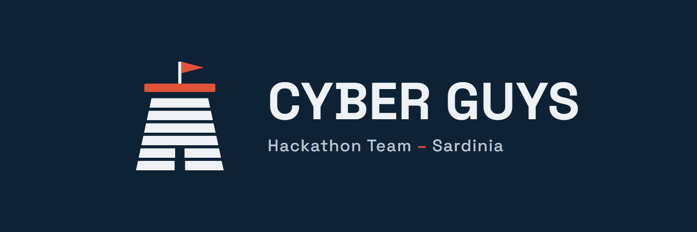
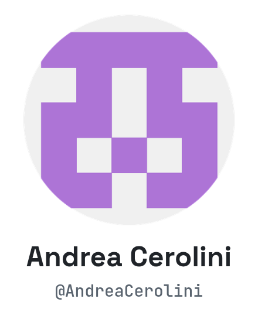
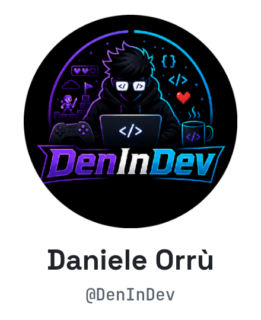

  

  A group of friends from Sardinia who build things at hackathons.

 

## Projects

| Date | Hackathon | Location | Project | Description | Position | Prize |
|---|---|---|---|---|:---:|---|
| Nov 2026 | [IXH26 Italian XRPL Hackathon](https://www.decifris.it/ixh26/) | Bari | [**Ripple Guardian**](https://github.com/Cyber-Guys/ripple-guardian) | Blockchain forensics framework for the XRP Ledger. Owners get plain-language alerts when keys change or funds leave; analysts trace stolen XRP hop by hop to the exchange and destination tag. | 2nd | €1,200 |
| Oct 2026 | [GreenLab Sardegna Hackathon](https://www.caor.camcom.it/eventi/greenlab-sardegna-hackathon-soluzioni-innovative-monitoraggio-ambientale) | Cagliari | **Sentinelle** | Citizen reporting and gamification against wildfires in Sardinia. Citizens report fires and complete prevention missions; operators get reports already verified and ranked by priority. | 2nd | - |
| Jun 2026 | [Code the Continuum, CEI-Sphere](https://ceisphere.eu/events/code-continuum) | Cagliari | **CoreFleet** | Proof of concept platform. | 1st + 3rd (2 tracks) | €750 + €300 |

## Team

  <a href="https://github.com/doliv8"><picture><source media="(prefers-color-scheme: dark)" srcset="assets/team/doliv8-dark.png"></picture></a>&nbsp;&nbsp;
  <a href="https://github.com/uNickz"><picture><source media="(prefers-color-scheme: dark)" srcset="assets/team/uNickz-dark.png"></picture></a>&nbsp;&nbsp;
  <a href="https://github.com/AndreaCerolini"><picture><source media="(prefers-color-scheme: dark)" srcset="assets/team/AndreaCerolini-dark.png"></picture></a>
    
  <a href="https://github.com/DenInDev"><picture><source media="(prefers-color-scheme: dark)" srcset="assets/team/DenInDev-dark.png"></picture></a>&nbsp;&nbsp;
  <a href="https://github.com/NicoXVI"><picture><source media="(prefers-color-scheme: dark)" srcset="assets/team/NicoXVI-dark.png"></picture></a>&nbsp;&nbsp;
  <a href="https://github.com/T0mm1-byte"><picture><source media="(prefers-color-scheme: dark)" srcset="assets/team/T0mm1-byte-dark.png"></picture></a>&nbsp;&nbsp;
  <a href="https://github.com/ale24cocco"><picture><source media="(prefers-color-scheme: dark)" srcset="assets/team/ale24cocco-dark.png"></picture></a>

